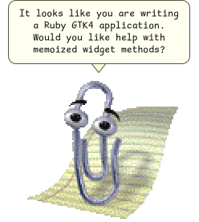

# clippy.rb

Clippy, the Office Assistant, as a GTK4 desktop overlay in Ruby: a frameless,
transparent, always-on-top window carrying the original sprite sheet and all 43
of its animations.



```
                 ┌──────────────────────────────┐
                 │ It looks like you are        │
                 │ writing a Ruby GTK4          │
                 │ application. Would you       │
                 │ like help?                   │
                 └──────────────┬───────────────┘
                                ▽
                             (Clippy)
```

## Running it

```sh
nix develop          # or: direnv allow
ruby exe/clippy
```

```
clippy [OPTION…]

  -a, --animation NAME   Animation to play on startup (default: Greeting)
  -s, --scale N          Sprite scale factor (default: 2)
  -l, --list             List the agent's animations and exit
      --wayland          Keep the Wayland backend (no always-on-top)
  -v, --version          Print the version and exit
```

| Interaction | Result |
|---|---|
| Drag Clippy | Move the overlay |
| Right-click | Menu: say hello, surprise me, all 43 animations, quit |
| Hover | A close button fades in at the bottom-right |

## The always-on-top problem

This is the only hard part, and it is worth stating plainly because the usual
advice for it is wrong for GTK4.

**GTK4 has no always-on-top call.** `gtk_window_set_keep_above` was deprecated
in GTK3 and *removed* in GTK4 — `Gtk::Window` does not define it, so any
recipe that calls `set_keep_above` crashes rather than degrading. The same goes
for `begin_move_drag`, which GTK4 replaced with `Gdk::Toplevel#begin_move`;
this project uses the latter for dragging.

Stacking is a window-manager policy decision, so the only route is to ask the
window manager:

| Session | Always-on-top | How |
|---|---|---|
| X11 | ✅ works | EWMH `_NET_WM_STATE_ABOVE` client message, sent via `wmctrl` |
| Xwayland (GNOME, KDE Wayland) | ✅ works | same, which is why `exe/clippy` defaults to `GDK_BACKEND=x11` |
| Wayland native | ❌ not possible | no protocol for it; see below |

Wayland deliberately gives applications no way to raise themselves.
`wlr-layer-shell` exists for exactly this purpose, but GNOME's Mutter does not
implement it and has declined to, so on a GNOME Wayland session **no**
application window can float above others — this is not a gap in this project.

`exe/clippy` therefore sets `GDK_BACKEND=x11` unless you pass `--wayland` or
set `GDK_BACKEND` yourself. Everything except always-on-top (transparency,
dragging, animation, the balloon) works natively on Wayland, and `--wayland`
avoids Xwayland's blurry scaling on a HiDPI display.

The app prints which of these happened on startup:

```
clippy: window set always-on-top via _NET_WM_STATE_ABOVE
clippy: Wayland session: always-on-top is not available to applications. …
clippy: wmctrl not found: install it for always-on-top (nix profile install nixpkgs#wmctrl)
```

`wmctrl` is in the dev shell and on the packaged wrapper's `PATH`. Note that
setting `_NET_WM_STATE` with `xprop` is *not* equivalent — it writes the
property behind the window manager's back, which then overwrites it on the next
state change. The client message is the supported route.

## How it is put together

| File | Role |
|---|---|
| `lib/clippy/agent.rb` | Loads the sheet and animation table; cuts and caches frame textures |
| `lib/clippy/sprite.rb` | Plays one animation: per-frame timing, branching, exit branches |
| `lib/clippy/balloon.rb` | The speech bubble, with a Cairo-drawn tail and its own dwell timer |
| `lib/clippy/overlay_window.rb` | The frameless transparent window, dragging, right-click menu |
| `lib/clippy/always_on_top.rb` | The window-manager negotiation described above |
| `lib/clippy/styles.rb` | CSS: window transparency and the bubble's look |
| `lib/clippy/application.rb` | Wires it together; `Clippy::Application.new.build.run` |

Two details are easy to get wrong and are worth knowing about:

**Frames are timed individually, not at a fixed rate.** Durations inside a
single Clippy animation range from 10ms to 1200ms, so the player schedules one
timeout per frame. A fixed-rate loop renders the animations visibly wrong.

**Animations branch.** 91 frames carry a weighted `branching` table and 267
carry an `exitBranch`. `Greeting` has a 40% chance of jumping from frame 0 to
frame 30, which is why it runs 3.7s most of the time and 1.0s the rest. This is
also why the speech balloon runs on its own reading-length timer rather than
hiding when the animation ends — tying the two together made sentences vanish
after a second.

The code follows the house style in `.claude/skills/ruby-gtk`: every widget is a
memoized method, configuration lives in its `tap`, assembly happens only in
`build`, and the launcher is one expression.

## Testing

GTK4 renders offscreen with no display server, so the UI tests need no Xvfb and
produce real screenshots:

```sh
env -u DISPLAY -u WAYLAND_DISPLAY ruby test/drive_overlay.rb   # 34 checks + screenshots in tmp/shots/
ruby test/test_agent.rb                                        # 10 — loading the sheet and cutting frames
ruby test/test_sprite.rb                                       # 10 — branching and exit rules
ruby test/test_overlay_window.rb                               #  8 — how the window is put together
ruby test/test_always_on_top.rb                                #  7 — backend detection
```

`rubocop` enforces the custom cops in `cops/`: no `return`, no modifier `if`, no
conditional assignment, `tap` where it applies.

## Assets

`data/clippy/` holds the Clippy sprite sheet and animation table taken from
[smore-inc/clippy.js](https://github.com/smore-inc/clippy.js). They are
Microsoft artwork, not covered by this project's licence — see
`data/clippy/PROVENANCE.md`. Point `Clippy::Agent` at another directory in the
same format to use a different agent.

## Known gaps

These are missing, not decided against:

- **No sound.** The agent format carries a `sound` id on 90 frames and the
  original ships 15 voice samples; neither the samples nor any audio playback
  have been written. The ids are preserved in `data/clippy/agent.json`.
- **No idle behaviour.** Clippy stands still between interactions. The agent
  has six idle animations (`IdleSnooze`, `IdleRopePile`, `IdleAtom`,
  `IdleHeadScratch`, `IdleFingerTap`, `IdleEyeBrowRaise`) that nothing
  currently schedules.
- **No click-through.** The transparent corners of the window still swallow
  mouse events, so Clippy's bounding box blocks clicks to whatever is behind
  it. GTK4 exposes no input-region API; this needs the platform surface.
- **Position is not remembered** between runs.
- **Only one agent is vendored.** The loader is general, but no agent-picking
  UI exists.
